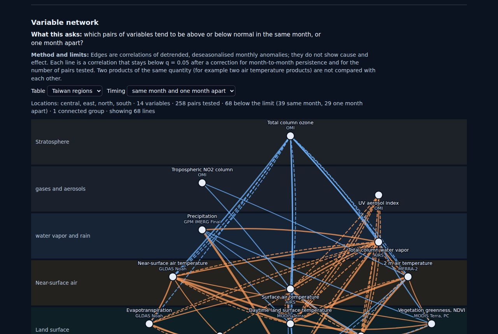

# Earth System Trend Detective

A web globe that shows NASA Earth-observation time series for Taiwan, twelve world cities and the global mean as layers of moving particles, and reports for each variable how fast it has changed per decade, with a 95% confidence interval and a significance test. It is our entry for the NASA Space Apps Challenge 2026 (Taichung local event), challenge [Be An Earth System Trend Detective!](https://www.spaceappschallenge.org/2026/challenges/earth-system-trend-detective/), and is aimed at students and curious members of the public.

**Live site: <https://nasa-hackathon-2026.github.io/earth-system-trend-detective/>** (static, no login, no server)

> TODO(team): add team name, a one-paragraph project statement in your own words, and the link to the demo (slides or 30-second video).

What it does not do yet, in short: outside Taiwan the site shows twelve world cities and the global mean for ten of the twelve layer variables (the two MODIS layers are Taiwan only) plus the global trend maps, the direction particles move in is illustrative (there is no wind data), and the data-mining page is exploratory. Details are under [Limitations](#limitations).

繁體中文摘要在[文末](#繁體中文摘要)。

## What you can do on the site

| Where | What it shows |
|---|---|
| Start card | The first visit opens with two layers already on (precipitation and MERRA-2 2 m air temperature at Taichung) and a card that says what the tool does, gives three steps (turn on a layer, play or drag the timeline, open Chart) and offers five examples to open. "How to read this" in the card explains the particles (one value at the selected place, not a map), the ▲ ▼ △ ▽ ◇ marks and the crossed-out triangle, what "not significant" means, the difference between in situ, satellite and model data, and the orange caution notes. The card closes for good once dismissed (remembered in the browser); the "? Guide" button at the top brings it back. A link that sets the view (`?layers=`, `?chart=`, ...) opens exactly that view, without the card. |
| [Globe](https://nasa-hackathon-2026.github.io/earth-system-trend-detective/) | A three.js Earth (NASA Blue Marble surface) with 12 layers you can switch on and off, one per variable: precipitation, near-surface air temperature, surface soil moisture, evapotranspiration, AIRS surface air temperature, total water vapor, MERRA-2 2 m air temperature, tropospheric NO2, total ozone, UV aerosol index, vegetation greenness (NDVI) and land surface temperature. |
| Particle forms | Each layer has its own particle shape and motion (water drops, jittering "thermal" spheres, water and ozone molecules, aerosol grains, leaves, ...). The count, size and speed of the particles follow the value for the selected place and month, scaled between that series' own minimum and maximum. |
| Calm particle style | A switch at the top of the Layers panel ("Particles: Calm / Lively", or `?particles=calm` in the URL; the choice is remembered in the browser) replaces the particles around the globe with one small, slow cluster per layer above the selected place. A small shape is one unit and five units combine into one big shape, on a scale of 1 to 25 units between that series' own lowest and highest month; the tinted disc is this month and the thin white ring is the mean of the same calendar month over the record, so a disc larger than the ring is a month above usual. A month with no data leaves a dashed ring only. Lively is the default. |
| Place and month | The place menu at the top of the Layers panel ("Values at", or `?at=<place id>`) chooses the place: five points in Taiwan (Taichung, Taipei, Kaohsiung, Hualien, Yushan), five Taiwan regions as area means (`?at=taiwan`, `north`, `central`, `south`, `east`; the globe outlines the data area, and the layer view is not offered for a region), twelve world cities (Tokyo, Delhi, Beijing, Jakarta, Cairo, Lagos, London, Moscow, New York, Los Angeles, São Paulo, Sydney) or the global mean. Picking a place turns the globe to it; the markers on the globe choose a place too. The month, every layer's value and trend, the chart, the companions and the layer view follow the place. A month slider chooses the month. A month with no data draws no particles and says "No data"; a variable with no series at the place says "No data at this place". |
| Timeline | A bar at the bottom plays through every month of the record (play/pause, 0.5, 2 or 6 months per second, "Latest"; Space and the arrow keys work too), and the particle layers follow. A thin strip above the slider shows each month's anomaly of one variable (above or below its calendar-month mean) and marks documented step months. `?month=YYYY-MM` and `?play=1` in the URL set the start. With the system's "reduce motion" setting, `?play=1` does not start playing. |
| Investigation panel (Chart) | The "Chart" button of a layer (or `?chart=<id>`) opens the investigation panel for that variable at the selected place: four numbered tabs, one per question of the challenge (`?tab=what|where|howmuch|significant` opens one directly). Each tab starts with a one-sentence answer generated from the results file and the same marks as the Layers panel, then a chart. ① What: the whole monthly record (values or 12-month running mean) with the trend line, the seasonal cycle that anomalies remove, the definition, unit, data type, product and period, and the other variables of the same question group (water, heat, air, plants). ② Where: one small chart of anomalies and trend per place (Taiwan points and regions, 12 world cities, global mean) on a shared or own scale; click one to go there. ③ How much: monthly anomalies with the trend and the 95% confidence band of its slope, the OLS and Sen changes per decade with their intervals on a number line centred on 0, the linear conversion over the period, and the numbers. ④ Significant?: the autocorrelation-corrected t-test and the three Mann-Kendall tests side by side with p, FDR-adjusted q and the same lights, a note when the two disagree, and the sentence that "not significant" is not "no change". Researchers also get residuals with months beyond ±3 robust SD, the residual autocorrelation (lags 1–24), the anomaly histogram and yearly means, a CSV and JSON download of the series and its result, and the methods. A cursor follows the timeline month; clicking a time chart jumps to that month. p values always come from the results file. |
| Trend per layer | The layer panel shows the linear change per decade of the monthly anomalies, its 95% confidence interval, and whether it is significant after autocorrelation and false-discovery-rate correction. ▲ ▼ mark significant rising or falling trends, hollow △ ▽ trends that are significant only before the FDR correction, ◇ marks "not significant". A significant trend of a series with a documented data issue that affects trends (a step in the product, or two products that disagree on the sign) gets a crossed-out triangle instead and the wording "statistically significant, but not reliable as a climate signal: see caution". Arrows above a layer on the globe appear only for significant trends without such an issue. The page opens with the camera over the selected place, which carries a ring and its name; a line under the timeline says that the particles show one value at that place and month and are not a map. |
| Global trend map | A selector at the top (off by default; `?trendmap=<id>` in the URL) lays the per-cell trend of one of seven variables over the globe: change per decade on a diverging colour scale (precipitation, both air temperatures from GLDAS and MERRA-2, AIRS surface air temperature, evapotranspiration, soil moisture, total water vapor). Cells significant after false-discovery-rate correction are in full colour, the other analysed cells are faded, cells with no data are left clear; colour strength also weakens toward zero change so the surface shows through small trends. The legend gives the unit, the colour range, the period and the method. |
| Close-up | Each layer has a "Close-up" button that opens a schematic view of the substance or process behind the variable (for example NO2 photolysis and ozone formation), with bond lengths and angles taken from NIST CCCBDB and the sources listed in the panel. |
| Data companions | A small panel left of the layer list shows one original character per layer that is switched on (Rain, Vapor, Ozone, NO₂, Haze, Warmth, Leaf, Soil and so on), drawn by code as SVG. Its size follows the month's value within the series' own range, its posture (swollen, level, flattened) whether the month is above, near or below the mean of the same calendar month, and the mark over its head the trend (▲ ▼ only when significant, ◇ when not, a crossed-out triangle when significant but not reliable as a climate signal). Clicking one shows a sentence of data facts only: value, difference from that month's mean, change per decade and its significance, any known-problem caution, and whether the data are in situ, a satellite retrieval or a model. A speaker button (off by default) reads it with the browser's own voice. "Gather" arranges all twelve in one composition; `?companions=gallery` shows them on one page. Interactions between neighbouring companions are illustrative and show no cause and effect. |
| Layer view | The "Layer view" button (also offered once you zoom in, or `?strata=1&at=<place id>` in the URL) flies to the selected place, tilts to an oblique view and pulls the Earth system there apart into six stacked platforms: stratosphere, troposphere (gases and aerosols), troposphere (water vapor and rain), near-surface air, land surface and top soil. Each platform lists its variables with the month's values and draws the particles of the layers that are switched on; rain falls from its platform to the land surface and evapotranspiration rises from it. Drag to turn, scroll to zoom, click a platform for its values, trend per decade, significance and cautions. The timeline keeps playing in this view, and a layer's "Chart" opens beside the Layers panel, so the stack, the six labels and the chart are visible together on a wide window. |
| [Model vs observation](https://nasa-hackathon-2026.github.io/earth-system-trend-detective/compare/) | Near-surface air temperature from models and reanalyses next to observations of the same quantity at the same place. Under "More" at the top of the globe page. |
| [Data mining](https://nasa-hackathon-2026.github.io/earth-system-trend-detective/mining/) | Five exploratory analyses, each with its method, sample size and a comparison against simple guesses: association rules (FP-growth) shown as small "A high and B low → C high" labels; a variable network (correlations of detrended monthly anomalies, drawn by layer of the Earth system, with the same lines as a table and a cross-check over 12 world cities); similar series (pick a place and a variable to list the most and least similar other variables, with small overlaid lines); where models and observations differ (mean size of the model-minus-station temperature difference by product, season, period and station, and a decision tree compared with three baselines, forward in time and on a held-out station); and the earlier decision tree for vegetation greenness, which did not beat its baselines. The chart panel of the globe page links to "Similar series" for the place and variable on screen. |
| [Form lab](https://nasa-hackathon-2026.github.io/earth-system-trend-detective/lab/) | Every particle form and close-up on its own, with a 0 to 1 value slider, for trying out how a value looks. |

| Close-up of tropospheric NO2 | Data mining page |
|---|---|
|  |  |

Screenshots were taken from a local build on 2026-11-15 in a headless browser, which draws fewer frames per second than a normal browser.

## How to use

1. Open the [globe](https://nasa-hackathon-2026.github.io/earth-system-trend-detective/). Two layers are on; the start card lists the steps and the examples.
2. Pick a place in "Values at" at the top of the Layers panel on the right (Taiwan, a world city or the global mean); the globe turns to it. Tick a layer below. The numbers next to it are the value at the selected place in the month shown, and the trend per decade with its significance. The "Particles" switch at the top of the panel chooses how the layers are drawn: Lively (particles around the globe) or Calm (one countable cluster per layer above the place, with a ring for what is usual for the month); `?particles=calm` or `?particles=lively` in the URL does the same.
3. Press play on the timeline at the bottom, or drag it, to watch the months go by.
4. Press "Chart" on a layer to open the investigation panel: four tabs (What is changing? Where? How much? Is it significant?), each with a one-sentence answer and a chart. Arrow keys move between the tabs; "Expand" widens the panel. `?chart=<id>&tab=howmuch` opens a tab directly.
5. "Layer view" shows which layer of the atmosphere or ground each variable belongs to; "Global trend map" lays one variable's per-cell trend over the globe; "More" leads to the model vs observation, data mining and form lab pages (and holds the renderer and FPS readout).
   "Fly near me" (top row, wide windows only) asks the browser for this device's location only when it is pressed and uses it inside the page to pick the nearest Taiwan point or world city; the location is not stored and not sent anywhere. Without a location (refused, unavailable or timed out) it flies to Taiwan.
6. On the data mining page, the row of links at the top jumps to each analysis; every section starts with the question it asks and its limits, and "Method details" opens the full method and parameters. "Similar series" at the bottom of a chart on the globe page opens that place and variable there.

The five examples on the start card are ordinary links, and so is the "Similar series" link at the bottom of a chart (the Tokyo row below is one of those; it is not on the card). Their titles are questions; the page shows the numbers and how they were computed, and leaves the answer to the reader.

| Example | Link |
|---|---|
| Has rainfall at Taichung changed since 2001? | [`?layers=imerg_precip&at=taichung&chart=imerg_precip`](https://nasa-hackathon-2026.github.io/earth-system-trend-detective/?layers=imerg_precip&at=taichung&chart=imerg_precip) |
| Has tropospheric NO₂ over Los Angeles changed since 2005? | [`?layers=omi_no2&at=los_angeles&chart=omi_no2`](https://nasa-hackathon-2026.github.io/earth-system-trend-detective/?layers=omi_no2&at=los_angeles&chart=omi_no2) |
| Which layer of the atmosphere or ground does each variable belong to? | [`?layers=omi_o3,omi_no2,imerg_precip,merra2_t2m,modis_ndvi,gldas_soilmoist&at=taichung&strata=1`](https://nasa-hackathon-2026.github.io/earth-system-trend-detective/?layers=omi_o3,omi_no2,imerg_precip,merra2_t2m,modis_ndvi,gldas_soilmoist&at=taichung&strata=1) |
| Do a model and a station agree on temperature? | [`compare/?pair=merra2_t2m__station_temp__taichung_station`](https://nasa-hackathon-2026.github.io/earth-system-trend-detective/compare/?pair=merra2_t2m__station_temp__taichung_station) |
| Which variables rose and fell in the same months as rainfall at Tokyo? | [`mining/?place=tokyo&variable=imerg_precip#similar`](https://nasa-hackathon-2026.github.io/earth-system-trend-detective/mining/?place=tokyo&variable=imerg_precip#similar) |
| Where on Earth has 2 m air temperature changed, and where is that change significant? | [`?layers=merra2_t2m&trendmap=merra2_t2m`](https://nasa-hackathon-2026.github.io/earth-system-trend-detective/?layers=merra2_t2m&trendmap=merra2_t2m) |

How the panel maps to the four questions of the challenge:

| Question | Tab | What answers it |
|---|---|---|
| What is changing? | ① What | The monthly record, its seasonal cycle, the variable's definition and data type; variables grouped as water (precipitation, soil moisture, evapotranspiration, water vapor), heat (2 m, near-surface and surface air temperature, land surface temperature), air (NO₂, ozone, aerosol) and plants (greenness) |
| Where is it changing? | ② Where | A default place (Taichung) and every other place (Taiwan points and regions, world cities, global mean) as a small chart; clicking one switches place |
| How much? | ③ How much | Change per decade of the monthly anomalies with its 95% CI and p, next to the Sen slope; the period and number of valid months |
| Is the change significant? | ④ Significant? | OLS t-test with lag-1 autocorrelation correction and the Mann-Kendall tests (original, Hamed-Rao, seasonal), FDR-adjusted; a note when they disagree; non-significant results stay on screen |

Everything can be reached with the keyboard (Tab, Enter or Space; Space and the arrow keys also drive the timeline), and with the system's "reduce motion" setting nothing plays by itself.

## Limitations

- **Language support is in progress.** English and Traditional Chinese cover the main interface. The data-mining page still shows some English technical prose supplied by analysis files and marks itself as partly translated. Japanese, German and French are translated (by AI tools, see the disclosure below) and have not been proofread by native speakers. Everyone, Student and Researcher change the wording and amount of detail, not the data or statistical result.

- **Seventeen points and one global mean on screen.** The site reads the point series of five places in Taiwan and twelve world cities, and the global mean. A city value is one grid cell of the product (0.1° to 1° wide, depending on the product), not a city boundary. Regional means for Taiwan and station series are in the data and in `data/analysis/trends.json`, but are not shown on the globe.
- **World places have ten of the twelve layer variables.** Vegetation greenness and land surface temperature (MODIS) were fetched for Taiwan only, so they say "No data at this place" elsewhere. At Moscow the NO2 and aerosol series have too many low-coverage months for a trend (the page says so). The global mean is the cos(latitude)-weighted mean of the whole grid, with no land mask, so it is not comparable with a point value; it has no marker and no layer view. The GLDAS cautions below apply to the world places as well.
- **Two FDR families.** The significance marks of the Taiwan series are corrected across the Taiwan series; those of the world cities and the global mean are corrected across the 130 series of the world subset (`data/analysis/world/trends.json`). The two corrections are separate.
- **Only the trend maps are global on screen.** The globe can show the per-cell trend maps of seven variables (about 1° cells, so detail inside a cell is averaged out; the colour range is a percentile of each map, so colours are not comparable between variables; no step-change detection). Of the rest of the global data, the site reads the world subset (ten core variables at twelve cities and as a global mean); the monthly grids themselves, the continental area means and the 121 extended variables exist in the data layer (see [NASA data](#nasa-data-and-resources)) but are not connected to the site.
- **Flow direction is illustrative.** The project has no wind data. Particles move in a fixed pattern per layer, and the page says so. Particle forms have no land mask, so leaves and soil water also appear over the sea.
- **The layer view's heights and flows are illustrative.** The platforms are equally spaced, not to scale. Total ozone, the NO2 column and total water vapor are totals over the whole air column and are drawn on the platform where most of the gas sits. Rain falling and evapotranspiration rising between platforms show the direction of the process only; nothing is measured along the path. The two troposphere platforms are the same layer of air drawn twice for readability. The ground image is a rough crop of the surface image around the place.
- **Close-up views are schematic** and not to scale. Molecular geometry has a source for each number; the textbook references and size figures (cloud droplets, raindrops, aerosol particles) have not been checked page by page.
- **The time series chart shows one variable at a time**, at the selected place. Its trend line is rebuilt from the slope in `data/analysis/trends.json` through the mean of the analysed months (the file stores no intercept), and the shaded band is the confidence interval of the slope, not a prediction interval. The chart does not redo any test in the browser.
- **Trends are linear only**, on monthly anomalies. Step changes from sensor or product-version changes are not detected or corrected. "Not significant" does not mean "no change"; the record may be too short or too variable.
- **The GLDAS air temperature trend contains step changes.** Compared with MERRA-2 over the same land cells, the GLDAS-2.1 global land mean shifts by about +0.4 K in May 2011, +0.6 K in July 2017 and −0.6 K in June 2019; these are months of upgrades to the NOAA GDAS analysis that GLDAS-2.1 uses as forcing. The site shows a caution next to this trend; the series is not corrected. The check and its sources are in [docs/data/gldas-tair-check.md](docs/data/gldas-tair-check.md).
- **GLDAS evapotranspiration has a step in 2024–2025; GLDAS soil moisture disagrees with FLDAS on the sign of the trend.** Compared with FLDAS (same Noah model family, MERRA-2 and CHIRPS forcing) over the same land cells, neither variable shows a clear step in the three months above. GLDAS evapotranspiration runs about 0.1–0.2 mm/day above FLDAS from July 2024 to May 2025, the same months in which its shortwave forcing runs 15–32 W m⁻² above FLDAS; the site shows a caution next to this trend. For 0–10 cm soil moisture the GLDAS global land trend over 2001–2026 is −0.43 kg m⁻² per decade against +0.16 for FLDAS; the two series correlate at only 0.08 and no step could be established. With a single model product to compare against, the check cannot tell which is closer to the truth; the site shows a caution that the two products disagree, and the drying trend should be treated as unconfirmed. See [docs/data/gldas-water-check.md](docs/data/gldas-water-check.md).
- **Data mining is exploratory.** It does not replace the trend tests and does not show cause and effect. Neither decision tree beat its baselines in walk-forward validation: the vegetation-greenness tree is above all three baselines in 0 of 3 folds, and so is the tree for the size of the model-minus-station difference (1 of 6 when a station is held out). Numbers are under [Data mining](#data-mining-exploratory).
- **Network lines and similar series are correlations.** They are computed on monthly anomalies over one period and say nothing about cause. The significance test corrects for lag-1 autocorrelation only, which is an approximation; places in the same table are neighbours and are not independent. Similarity is computed without removing trends, so two series that both drift look similar for that reason alone; the page lists the value after removing trends next to it and marks the pairs that change (599 of the 1,480 listed). The similar-series lists only search among the 185 series shown on the site, and the model-versus-station analysis covers Taiwan stations and air temperature only (11 pairs at 6 stations); the world cities are not in it.
- **"Places that move alike" is not offered on the globe.** Its arcs mostly join a place to other variables at the same place, or to Taiwan places a few pixels apart, so nothing is visible from the global view. The similar series are on the data-mining page; drawing them on the globe is future work.
- **Per-place trend marks and the trend map are not drawn together.** While a global trend map is on, the per-place marks are hidden (the legend says so), because the two pictures use different units of space: a grid cell and a point.
- **Units are as provided by each product** (for example K for MERRA-2, °C for NASA POWER); the layer panel converts Kelvin to °C for display only.
- **A close-up covers the chart.** The close-up panel opens over the left side of the page, on top of an open time series chart; close it to see the chart again.
- **Phone widths are simplified.** The Layers and Companions panels start folded, "Fly near me" is left out of the top row, the layer view shows values without variable names in its labels (tap a label for the names) and hides the companion panel, and an open chart covers the layer view until it is closed. Between 701 and 1180 px, an open chart takes the place of the Layers panel in the layer view, and below 900 px the companion panel gives way to an open chart.
- Performance has not been measured on real phones.

## NASA data and resources

All series are stored as monthly values in one common format. The lists below are generated from the snapshot catalog: [docs/data/nasa-data.md](docs/data/nasa-data.md) (NASA products, versions, periods, DOIs) and [docs/data/references.md](docs/data/references.md) (non-NASA data and software).

| Product (variables) | Access route | Used for |
|---|---|---|
| GPM IMERG Final monthly (precipitation); GLDAS Noah (air temperature, soil moisture 0–10 cm, evapotranspiration); AIRS (surface air temperature, total column water vapor); MERRA-2 (2 m air temperature); OMI (tropospheric NO2, total ozone, UV aerosol index) | NASA **Giovanni** time-series API | Point series at five places |
| The same ten variables | NASA **Harmony** / Giovanni averaging service | Area means over five Taiwan boxes |
| MODIS Terra NDVI (MOD13A3) and daytime land surface temperature (MOD11A2) | NASA **AppEEARS** area requests | Area statistics for the Taiwan boxes |
| MODIS Terra MOD11A2 and MOD13Q1 | **Microsoft Planetary Computer** (STAC, cloud-optimized GeoTIFF), statistics computed locally | Point series for the two MODIS layers; a second, separately stored set of area series |
| MERRA-2 2 m air temperature | **NASA POWER** monthly API | Cross-check of the MERRA-2 series |
| IMERG, GLDAS, AIRS, MERRA-2, FLDAS, OMI global grids | NASA CMR + **Earthdata Cloud OPeNDAP** | Global monthly grid cubes; area means computed locally |
| Station air temperature, Taichung and Taipei (NOAA GHCNh; not NASA) | AWS Open Data | Ground validation layer only; monthly means only |

The globe surface is NASA Blue Marble (NASA Visible Earth), and the closer views of Taiwan and of the twelve world cities are Blue Marble shaded relief from NASA GIBS (layer `BlueMarble_ShadedRelief_Bathymetry`, 500 m; a city's tile is fetched from GIBS only when the camera comes close to it). The use of monthly anomalies with a linear trend follows Acker et al. 2009 (SeaWiFS chlorophyll time series), a paper on the challenge's resource list.

How much data there is:

| Tier | Size | In git? | Shown on the site? |
|---|---|---|---|
| **Core snapshot** (`data/snapshot/`) | 16 variables (15 NASA, 1 NOAA station), 12 locations, 133 monthly series: 65 point, 66 area-mean, 2 station. Records start between 2000 and 2004 and run to the latest month available on 2026-11-14. | Yes | Point series of 12 variables |
| **World subset** (`data/snapshot/world/`) | The ten core Giovanni variables at 12 world cities (point series) and as a global mean (computed from the global grids): 130 series, copied unchanged from the extended series and the grid area means by `uv run python -m trend_detective.world_export`. Their trends are in `data/analysis/world/`. | Yes | Yes, through the place menu |
| **Extended series** (`data/extended/`) | 121 more Giovanni variables at the Taiwan points and 12 world cities, plus the core variables at the world cities: 2,177 point series | No (large) | No |
| **Global grids** (`data/raw/grid/`) | 345 monthly cubes at native resolution (about 90 GB); 4,499 area-mean series for the globe, world regions and Taiwan boxes computed from them | No | No |
| **Grid files for the web** (`data/grid/`) | Seven variables reduced to about 1°: annual mean, monthly climatology, and the per-cell trend maps (slope per decade and its significance after FDR correction) | Yes | The trend maps only (Global trend map) |

The core data is also available as a SQLite file (about 44 MB) on the [releases page](https://github.com/nasa-hackathon-2026/earth-system-trend-detective/releases/tag/data-2026-11-15); see [docs/data/sqlite.md](docs/data/sqlite.md) for the tables and example queries. The same release also holds the cleaned data of all tiers (6,889 series): `clean_observations.csv.gz` (the cleaned monthly observations with their quality flags, about 55 MB), `clean_series.csv` (one row per series), `trend_detective_pg17_2026-11-15.dump` (a `pg_dump` of the PostgreSQL cleaning database, about 447 MB) and `SHA256SUMS`. The tables and columns are described in [docs/data/database-schema.md](docs/data/database-schema.md), and how to restore the dump in [docs/data/database-backup.md](docs/data/database-backup.md). Where raw downloads are kept and how each source is fetched is in [docs/data/raw-data.md](docs/data/raw-data.md). These pages are in Traditional Chinese.

## Methods

### Common format and monthly values

Every series is one JSON file with the same fields (variable, location, aggregation, unit, source request, and a list of months with `value`, `coverage` and `n_samples`), listed in `data/snapshot/catalog.json`. The site and the statistics read only these files, so the site needs no server.

- Daily products (OMI) and 8- or 16-day composites (MODIS) are averaged to months; `coverage` records how much of the month had data. Missing months are left missing, with no gap filling.
- Units are kept as the product provides them.
- Each file records the grid cell actually used. Where a coastal cell is masked, the request is moved one cell inland and both coordinates are recorded.
- "Area mean" is over a latitude–longitude box, not a land mask, so it includes sea cells for every product except the land-only models. Comparing absolute values across products is misleading. `coverage` is defined differently by source.

### Trend statistics

For each series (`src/trend_detective/trends.py`, results in [`data/analysis/trends.json`](data/analysis/trends.json)):

1. Months with coverage below 0.25 are dropped. A series with fewer than 120 usable months or more than 20% missing is marked `insufficient` and not tested.
2. **Monthly anomalies**: each value minus the mean of the same calendar month, which removes the seasonal cycle.
3. **Linear trend**: least-squares slope of the anomalies, reported per decade. The standard error, t-test and 95% confidence interval use an effective sample size from the lag-1 autocorrelation of the residuals (Santer et al. 2000).
4. **Mann-Kendall** in three versions (original, Hamed-Rao variance correction, seasonal) and the **Theil-Sen slope** with its confidence interval.
5. **Benjamini-Hochberg FDR** across all series of the run, separately for each test.

The site uses the autocorrelation-corrected t-test with FDR for its "significant" label.

Results of the run on the 2026-11-14 snapshot ([`trends.run.json`](data/analysis/trends.run.json)): of 133 series, 130 were analysed and 3 had too many missing months (tropospheric NO2 at Hualien, Taipei and Yushan).

| Test | Series tested | p < 0.05 | Still below 0.05 after FDR |
|---|---|---|---|
| Linear trend, t-test with autocorrelation correction | 130 | 83 | 74 |
| Linear trend, t-test without correction (for comparison) | 130 | 101 | not computed |
| Mann-Kendall, original | 130 | 88 | 86 |
| Mann-Kendall, Hamed-Rao | 129 | 69 | 65 |
| Seasonal Mann-Kendall | 130 | 89 | 86 |

These are counts of series, many of which are closely related (the same variable at neighbouring places, products derived from the same source), so they are not 130 independent findings.

Known pitfalls and how they are handled:

| Pitfall | Handling |
|---|---|
| Autocorrelation makes p-values too small | Effective sample size for the t-test. On synthetic AR(1) series (phi 0.7, 240 months, 300 runs) the false-positive rate was 38% uncorrected, 6% corrected, and 18% for Hamed-Rao, so the Hamed-Rao result is on the lenient side. The Sen slope interval has no autocorrelation correction. |
| Seasonal cycle | Monthly anomalies; the seasonal Mann-Kendall test as a second view. |
| Many tests at once | Benjamini-Hochberg FDR; both raw and adjusted results are stored. |
| Short or gappy records | Minimum of 120 usable months and at most 20% missing, otherwise not tested. |
| Sensor or product-version changes | **Not handled.** A step change would be read as a trend. |

### Data mining (exploratory)

Five analyses, all marked `exploratory: true` in their result files and all shown on the [data mining page](https://nasa-hackathon-2026.github.io/earth-system-trend-detective/mining/). Parameters were fixed before each run and are stored in the result files and their run records (`*.run.json`); every run that was made is listed. Method, leakage guards, baselines, result tables and limits of the three newer analyses are in [`docs/data/mining.md`](docs/data/mining.md) (in Traditional Chinese).

**Association rules and the vegetation-greenness tree** (`src/trend_detective/mining.py`, results in [`data/analysis/fpgrowth.json`](data/analysis/fpgrowth.json) and [`decision_tree.json`](data/analysis/decision_tree.json)):

- **Input**: monthly anomalies with each series' own linear trend removed, so the states describe month-to-month variation, not the long-term trend. Each value is labelled low, normal or high by that series' own terciles. One place in one month is one row.
- **Near-duplicate variables** are dropped by a fixed rule (absolute correlation above 0.85 with a variable earlier in the catalog). In this run that removed NASA POWER temperature from the point table (r = 1.000 with MERRA-2), and MERRA-2 temperature (r = 0.858 with GLDAS) and the second land surface temperature series (r = 0.972 with the first) from the region table. Gaps in the mining input are filled by a fixed rule (short gaps interpolated, longer gaps set to the monthly climatology); the page compares the filled and unfilled runs.
- **Association rules (FP-growth)**: minimum support 0.05, confidence 0.6, lift 1.5, at most three items, the two sides never the same variable. Each rule gets a one-sided Fisher exact test with FDR correction. Result: 367 same-month rules from 1,260 point rows; 259 same-month rules and 1 one-month-lag rule from 1,008 region rows. Every candidate rule passed the significance filter, because rows are not independent (neighbouring months and places) and the p-values are therefore optimistic; in practice the lift threshold does the filtering.
- **Decision tree**: predicts the low/normal/high state of regional NDVI from the other variables in the same and the previous month (depth 3), with three walk-forward folds. NDVI's own previous month and the second NDVI series are not allowed as features. Monthly means, trend and thresholds are estimated from the training months of each fold only.

Decision tree test accuracy against three guesses that use no other variable:

| Fold (test period) | Tree | Always guess the training period's most common class | Always guess the test period's most common class (known only afterwards) | Same as the previous month |
|---|---|---|---|---|
| 1 (2014-11 to 2018-06) | 0.462 | 0.273 | 0.455 | 0.470 |
| 2 (2018-07 to 2022-02) | 0.455 | 0.265 | 0.402 | 0.583 |
| 3 (2022-03 to 2025-09) | 0.310 | 0.279 | 0.426 | 0.566 |

The tree is above all three baselines in 0 of 3 folds. We report it as it is: with these inputs the tree has no demonstrated predictive value, and the page says so.

**Where models and observations differ** (`src/trend_detective/gap_tree.py`, result in [`data/analysis/gap_tree.json`](data/analysis/gap_tree.json)). Input: the 11 Taiwan pairs of a weather station with GLDAS or MERRA-2 air temperature at the same place (6 stations, 3,273 pair-months, 2001-01 to 2025-12). NASA POWER is left out because it serves MERRA-2 fields.

Mean of |model anomaly − station anomaly| in °C, with a 95% interval from a bootstrap that resamples whole calendar years:

| Group | GLDAS | MERRA-2 |
|---|---|---|
| All months | 0.51 (0.47 to 0.54), n = 1,488 | 0.32 (0.30 to 0.35), n = 1,785 |
| Dec–Feb | 0.54 (0.49 to 0.59) | 0.36 (0.32 to 0.39) |
| Mar–May | 0.51 (0.48 to 0.55) | 0.31 (0.28 to 0.35) |
| Jun–Aug | 0.48 (0.43 to 0.54) | 0.32 (0.29 to 0.36) |
| Sep–Nov | 0.48 (0.43 to 0.55) | 0.29 (0.26 to 0.33) |
| Before 2011-05 | 0.49 (0.44 to 0.55) | 0.31 (0.30 to 0.33) |
| 2011-05 up to 2017-07 | 0.47 (0.42 to 0.51) | 0.30 (0.26 to 0.35) |
| 2017-07 up to 2019-06 | 0.63 (0.56 to 0.71) | 0.29 (0.28 to 0.33) |
| From 2019-06 | 0.53 (0.51 to 0.55) | 0.35 (0.30 to 0.42) |

The periods are cut at the documented step months of the GLDAS air temperature; MERRA-2 is split at the same months only for comparison. By station the GLDAS mean runs from 0.31 (Taipei) to 0.66 (Taichung) and the MERRA-2 mean from 0.26 (Lanyu) to 0.36 (Kaohsiung airport). These numbers do not say which side is right.

The decision tree predicts whether the difference of a month is small, medium or large (cut at the terciles of the training rows) from the calendar month, the model product, the GLDAS period number, the station, the low/normal/high state of eight non-temperature variables at the nearest core point, and the state of the station's own anomaly; 2,518 rows, depth 3. Leakage guards: the model anomaly, the station anomaly and their difference are never features; temperature variables are not features; the target's own previous month is not a feature; a run stops if any single feature classifies more than 95% of the training rows; and every cut point, calendar-month mean and trend is estimated from the training months only.

| Test period (walk-forward) | Tree | Training-majority guess | Same as the previous month | Most common class of the calendar month |
|---|---|---|---|---|
| 2014-10 to 2018-05 | 0.296 | 0.212 | 0.470 | 0.406 |
| 2018-06 to 2021-12 | 0.378 | 0.456 | 0.497 | 0.306 |
| 2022-01 to 2025-06 | 0.365 | 0.538 | 0.479 | 0.365 |

The tree is above all three baselines in 0 of 3 folds. Trained on five stations and tested on the sixth, it is above all three in 1 of 6 (Tainan); mean accuracy 0.391 against 0.427 for the previous-month guess. Two more runs are listed on the page: without the GLDAS period number (also 0 of 3 and 1 of 6) and, as a reference only, with the pair's own previous class as a feature (0 of 3 and 1 of 6). No other settings were tried.

**Variable network** (`src/trend_detective/variable_graph.py`, result in [`data/analysis/variable_graph.json`](data/analysis/variable_graph.json)). Pairwise correlations of detrended monthly anomalies of the Taiwan core series, in the same month and one month apart, with a t-test on an effective sample size corrected for the lag-1 autocorrelation of both series and Benjamini-Hochberg FDR over all tests of a table. Products of the same quantity are not compared with each other. Result: at the 5 points, 13 variables, 216 tests, 31 below q = 0.05 (20 same month, 11 one month apart), 3 connected groups (NO2 and NDVI have no line); in the 4 regions, 14 variables, 258 tests, 68 below the limit (39 and 29), 1 connected group. Connected groups and link counts were computed in Python (union-find) and in PostgreSQL (pgRouting) and agree for every variable. In the 12 world cities (10 variables, each city tested on its own, 1,461 tests), 333 are below the limit; precipitation with soil moisture and soil moisture with evapotranspiration are below it in all 12 cities with the same sign.

**Similar series** (`src/trend_detective/similar_series.py`, result in [`data/analysis/similar_series.json`](data/analysis/similar_series.json)). The pgvector embeddings of the cleaning database (248 monthly anomalies, 2005-01 to 2025-08, standardised, so cosine similarity equals the Pearson correlation) for the 185 series shown on the site: 57 at the Taiwan points, 118 at the world cities, 10 global means. For each series the five most similar and three least similar series of a different variable are listed. Of the 14,577 candidate pairs, 2,125 are below q = 0.05 after the autocorrelation correction and FDR over all candidate pairs, and 820 after each series has its own linear trend removed; of the 1,480 listed pairs, 1,286 and 695.

## How to reproduce

You need [uv](https://docs.astral.sh/uv/) (Python 3.11 or later) and Node.js 22 or later. Run everything from the repository root. The commands in the first table need no account and no network beyond package installation; each was run on a clean checkout on 2026-11-15.

| Step | Command | Notes |
|---|---|---|
| Install the data layer | `uv sync --locked` | |
| Run its tests | `uv run pytest` | 513 passed, 27 skipped without the local PostgreSQL database (the skipped tests need it; the run with the database was not repeated for this count) |
| Recompute trend statistics | `uv run python -m trend_detective.trends` | About 3 s. Reads `data/snapshot/`, writes `data/analysis/trends.json`, `anomalies.json`, `trends.run.json`. Only the run timestamp changes if the data is unchanged. |
| Recompute data mining | `uv run python -m trend_detective.mining` | About 3 s. Run after the trend step. |
| Recompute the model-versus-station tree | `uv run python -m trend_detective.gap_tree` | About 3 s. Reads `data/analysis/model_vs_obs.json` and `anomalies.json`; no database needed. |
| Recompute the variable network | `uv run python -m trend_detective.variable_graph --no-db` | About 3 s. Without `--no-db` it also runs the pgRouting cross-check, which needs the local PostgreSQL database (`docs/data/postgres.md`). |
| Recompute similar series | `uv run python -m trend_detective.similar_series` | Needs the local PostgreSQL database with the series embeddings; not reproducible from a fresh clone alone. |
| Regenerate the data lists | `uv run python -m trend_detective.data_lists` | Rewrites `docs/data/nasa-data.md` and `references.md` from the catalog. |
| Build the SQLite file | `uv run python -m trend_detective.sqlite_export` | Writes `data/sqlite/trend_detective.sqlite` (not in git). On a fresh clone the unified table is complete (133 series, 39,264 rows) and the per-source raw tables are empty, because raw downloads are not in git. |
| Install the web app | `npm ci --prefix web` | |
| Run its tests | `npm test --prefix web` | 316 passed |
| Start the site locally | `npm run dev --prefix web` | Open `http://localhost:5173/earth-system-trend-detective/` (also `compare/`, `mining/` and `lab/` under it). |
| Build the site | `npm run build --prefix web` | Output in `web/dist/`, including a copy of `data/snapshot/` and `data/analysis/`. GitHub Pages runs this on every push to `main`. |

Fetching the data again talks to NASA services. These commands were **not** re-run for this README; they are documented in `AGENTS.md` (in Traditional Chinese) with timings and pitfalls.

| Step | Command | Needs |
|---|---|---|
| Regenerate the whole core snapshot | `uv run python -m trend_detective.snapshot` | An Earthdata Login token as `EARTHDATA_TOKEN` in a local `.env` for Giovanni and Harmony. Without it those two sources are skipped and existing files are kept. Uses the team's shared Giovanni quota. About 3–10 minutes. |
| Only the sources that need no account | `uv run python -m trend_detective.snapshot --source noaa_ghcnh --source nasa_power` | Network only. |
| MODIS via Planetary Computer | `uv run python -m trend_detective.planetary_computer fetch`, then `uv run python -m trend_detective.snapshot --source planetary_computer` | No account. About 9 minutes and 1.5 GB of downloads. |
| MODIS via AppEEARS | `uv run python -m trend_detective.appeears submit`, later `status` and `download` | An AppEEARS token (`APPEEARS_TOKEN`). Tasks are asynchronous and can queue for hours. |
| Extended series | `uv run python -m trend_detective.extended` | `EARTHDATA_TOKEN`. Point series only by default; continental area means through Harmony use up the shared quota and are not sent. |
| Global grids | `uv run python -m trend_detective.grid_fetch` (see `AGENTS.md` for the per-product options) | `EARTHDATA_TOKEN`. Tens of GB of downloads. |
| Area means from the grids | `uv run python -m trend_detective.grid_regions` | Offline, but needs the grid cubes from the previous step. |

## Repository layout

| Path | Contents |
|---|---|
| `data/snapshot/` | Core snapshot: `catalog.json` and one JSON file per series. Read by the site. |
| `data/analysis/` | Trend and data-mining results with their run records (`*.run.json`). Read by the site. |
| `data/grid/` | Reduced global grid files for seven variables. The site reads the trend maps (`meta.json`, `trend_slope_per_decade.i16`, `trend_significance.u8`); the annual means and monthly climatologies are not used by the site yet. |
| `data/seed/` | Lists of variables, locations and grid products that drive the fetch scripts. |
| `data/raw/`, `data/extended/`, `data/sqlite/` | Raw downloads, extended series, SQLite export. Not in git. |
| `src/trend_detective/` | Python data layer: one module per source, plus `snapshot`, `trends`, `mining`, `gap_tree`, `variable_graph`, `similar_series`, `grid*`, `sqlite_export`. |
| `tests/` | pytest tests for the data layer, with small fixtures; they do not use the network. |
| `web/` | Vite + React + three.js site: the globe (`web/src/`), the model vs observation page (`web/compare/`), the mining page (`web/mining/`), the form lab (`web/lab/`), and a minimal line-chart check page (`web/tracer/`). |
| `docs/data/` | Generated data lists, raw-data notes, SQLite and PostgreSQL guides, the model-versus-observation and data-mining method notes. |
| `docs/adr/` | Architecture decision records for the cleaning database (in Traditional Chinese); the table-and-column reference is `docs/data/database-schema.md`. |
| `docs/images/` | Screenshots used in this README. |
| [`docs/submission/`](docs/submission/) | Draft of the Space Apps submission form (English), a structure suggestion for the demo, and a pre-submission checklist (Traditional Chinese). For the team to rewrite and verify. |
| `docs/agents/`, `AGENTS.md`, `CLAUDE.md`, `.claude/`, `.codex/` | Instructions and configuration for the coding agents used in development; see [docs/agents/README.md](docs/agents/README.md). |
| `.github/` | Issue and pull-request templates, and the GitHub Pages workflow. |

## Use of AI (SI) — disclosure

Space Apps 2026 calls AI tools "Super Intelligence (SI)". In short: AI tools wrote the code, interface copy and documentation of this project and helped define and tune parameters; the direction and the decisions are the team's. **Claude Code (Anthropic)**, **Cursor** and **Codex (OpenAI)** were used in the repository. The team owner (GitHub account [Grasonyang](https://github.com/Grasonyang)) confirmed on 2026-11-15 that Claude Code and Cursor were the tools used before this multilingual work. Codex appears in the repository's record after that. These three are the tools named in the commit trailers and pull-request descriptions; if the demo or the submission materials use a further tool, the team adds it. The details below come from the repository's own record (commit trailers, pull-request descriptions, issue comments) and from the "決定的分工" paragraph at the end of each record in [docs/adr/](docs/adr/) (in Traditional Chinese), which the team owner checked item by item on 2026-11-15.

### Which tools were used, and for what

**Claude Code** wrote the code, tests, data-processing scripts and documentation, and the interface elements and characters that are drawn by program code. Its commits carry a `Co-Authored-By: Claude` trailer and its pull requests say "Generated with Claude Code".

- **Data layer** (`src/`, `tests/`, the fetch scripts, the common format, trend statistics, data mining, the SQLite export and the PostgreSQL cleaning database), the data documentation and this README: written by Claude Code under a team member's direction.
- **Web front end, later parts** (trend summary in the layer panel, the mining page, the ten additional particle forms, the close-up views and their text; pull requests #57, #58, #62, #65): implemented by Claude Code.
- **Web front end, parts added on 2026-11-15** (the global trend map, the timeline and time series chart, the layer view, the start card and its examples, the world cities and the global mean in the place menu, and the model vs observation page; issues [#72](https://github.com/nasa-hackathon-2026/earth-system-trend-detective/issues/72), [#97](https://github.com/nasa-hackathon-2026/earth-system-trend-detective/issues/97), [#99](https://github.com/nasa-hackathon-2026/earth-system-trend-detective/issues/99), [#101](https://github.com/nasa-hackathon-2026/earth-system-trend-detective/issues/101), [#105](https://github.com/nasa-hackathon-2026/earth-system-trend-detective/issues/105), [#107](https://github.com/nasa-hackathon-2026/earth-system-trend-detective/issues/107)): implemented by Claude Code.
- **Data companions** (the characters in the companion panel): the code that draws the characters and fills in their sentences was written by Claude Code following the team's design. The characters are drawn by that code as SVG shapes; no AI-generated image, no external image, font or audio file is used, and the voice is the browser's built-in speech synthesis. The sentences are templates filled with numbers from the data; they state no cause and no conclusion.
- **Data-mining additions** (the model-versus-station tree and its table of group means, the variable network, the similar-series lists, and the reworked mining page; [#111](https://github.com/nasa-hackathon-2026/earth-system-trend-detective/issues/111)): the code and the page text were written by Claude Code following the team's direction. The page gives numbers and methods and states no cause and no conclusion.
- **Interface copy and translations**: the English and Traditional Chinese interface copy, and the Japanese, German and French translations of it (including the investigation panel), were written by AI tools (Claude Code and Codex) following the team's direction. **The Japanese, German and French translations have not been proofread by native speakers.**

**Cursor** was used by a team member to develop the main structure of the web front end (three.js scene, globe, layers, form lab, reading the snapshot; pull requests #27, #29, #30, #33, #38, #42, #44). Those commits carry a `Co-authored-by: Cursor` trailer and the pull requests say "Made with Cursor". Later pull requests by a team member also carry that trailer or description: #153 and #154 ("Made with Cursor" in the description), #160, #174 and #181 (`Co-authored-by: Cursor` in the commit).

**Codex** continued issue #131: multilingual message infrastructure, reader-role controls, companion tour and this disclosure. Its `Co-Authored-By: Codex` trailer is on the commit that integrated the five front-end issues #131–#135 with layout fixes ([#147](https://github.com/nasa-hackathon-2026/earth-system-trend-detective/pull/147)), the speech-voice selection by interface language (#152), the world-city camera glide (#154) and the commit that merged the reviewed Layers-panel accordion into `main` (#159; the accordion itself was opened in #157, whose description says "Generated with Claude Code"). The English and Traditional Chinese interface copy has not been independently reviewed by a native-speaking science editor (see "Interface copy and translations" above for the translations).

### What the team decided

The direction, the ideas and the trade-offs are the team's. The decisions recorded in the data-layer spec ([#4](https://github.com/nasa-hackathon-2026/earth-system-trend-detective/issues/4)) and in the decision records in [docs/adr/](docs/adr/) were made by the team (confirmed by the team owner on 2026-11-15); the team's discussion of the project's direction is in [#3](https://github.com/nasa-hackathon-2026/earth-system-trend-detective/issues/3).

- The layered-globe design, one glass-and-particle layer per variable ([#19](https://github.com/nasa-hackathon-2026/earth-system-trend-detective/issues/19)), and the first two particle forms ([#20](https://github.com/nasa-hackathon-2026/earth-system-trend-detective/issues/20)).
- The visual direction of a far view of particles and a close-up of molecules and processes, with values driving count, size and speed ([#60](https://github.com/nasa-hackathon-2026/earth-system-trend-detective/issues/60)).
- Starting with Taiwan, and using decision trees and FP-growth as the data-mining methods ([#55](https://github.com/nasa-hackathon-2026/earth-system-trend-detective/issues/55)); later, using the decision tree on the difference between models and observations and putting the database's similar-series and variable-graph results on the site ([#111](https://github.com/nasa-hackathon-2026/earth-system-trend-detective/issues/111)).
- The presentation ideas of the data companions (one pet-like character per form of matter, shown together in a composition after *The School of Athens*) and of the layer view.
- A public site that reads only static files ([#4](https://github.com/nasa-hackathon-2026/earth-system-trend-detective/issues/4)), and PostgreSQL with its extensions as the one place where data of different sources and shapes are put in order ([ADR 0001](docs/adr/0001-postgres-as-rebuildable-working-database.md), [ADR 0005](docs/adr/0005-postgres-extensions-and-portability.md)).
- Cleaning the whole database and handling missing values, including the two candidate ways of filling them that the tool was asked to choose between ([ADR 0002](docs/adr/0002-raw-values-never-overwritten.md), [ADR 0003](docs/adr/0003-missing-value-policy.md)).
- Dividing the data into model output and observations, keeping GLDAS in the project with cautions next to its trends instead of removing it, and which observation sources to add (GISTEMP, GHCNm, Taiwan stations, SMAP) ([ADR 0004](docs/adr/0004-tiers-data-kind-model-vs-observation.md)).

### What the tools helped define and tune

Within those decisions, the following details were worked out with Claude Code:

- **Cleaning rules**: raw values are never overwritten, the kinds of quality flag and their thresholds, verified data problems stored as rows, and steps in the data flagged but not corrected. Reviewed and adopted by the team owner on 2026-11-15 ([ADR 0002](docs/adr/0002-raw-values-never-overwritten.md)).
- **Missing values**: the team proposed two candidate approaches and left the choice to the tool. The tool chose the one closer to "use the mean" and refined it: short gaps are interpolated linearly, longer gaps are set to the monthly climatology, and nothing is filled for the trend tests. The team can change this ([ADR 0003](docs/adr/0003-missing-value-policy.md)).
- **Multiple-testing parameters**: Benjamini-Hochberg FDR, α = 0.05, and which series are corrected together as one family. Reviewed and adopted by the team owner on 2026-11-15 ([ADR 0006](docs/adr/0006-fdr-families.md)).
- **Data-mining parameters**: the default thresholds were chosen by the tool following rules a team member authorised, and are recorded in the result files ([#59](https://github.com/nasa-hackathon-2026/earth-system-trend-detective/issues/59)); the fixed parameters of the later mining additions were set by the tool before each run ([#111](https://github.com/nasa-hackathon-2026/earth-system-trend-detective/issues/111)).
- **Proposed by the tool** and recorded as such in the ADRs: applying one shared cleaning function to the series files instead of reading the database tables (ADR 0001), the wording "model vs observation" and the form of the GLDAS cautions after the checks (ADR 0004), and the list of candidate PostgreSQL extensions with their uses (ADR 0005).
- **Defaults drafted by the tool for the team to change**: the mapping from each variable to a particle shape, and the wording and reaction equations in the close-ups ([#60](https://github.com/nasa-hackathon-2026/earth-system-trend-detective/issues/60)).

### What is not AI-generated

- **All data values** come from the NASA products, NASA POWER and NOAA GHCNh listed above, through the scripts in this repository. No value is generated or filled in by an AI model. The statistics are computed by ordinary code (NumPy, SciPy, pymannkendall, mlxtend, scikit-learn).
- The screenshots are captures of the running site. The globe textures are NASA imagery. No NASA logo or insignia is used.
- The repository and the site contain no AI-generated image, video or audio file: the tracked media are the three screenshots, the two NASA textures and the page icon (`web/public/favicon.svg`, a circle and a line written as SVG code in a commit co-authored by Claude Code).

### Still open

> TODO(team): confirm that the idea for the project came from the team's own brainstorm ([#3](https://github.com/nasa-hackathon-2026/earth-system-trend-detective/issues/3)) and say so here in your own words. The rules state that SI must not be used to come up with the idea.

For reference when writing that statement: the items under "What the team decided" above are the ones the issues and the ADRs record as proposed and decided by the team.

> TODO(team): two questions about this disclosure are still unanswered. Were issue texts and specifications drafted with an AI tool? Does the demo (slides or video, which does not exist yet) use any AI tool or AI-generated image, audio or video? Those need a visible watermark, and any further tool has to be added to the list above.

> TODO(team): the team's own checklist proposed a header comment in AI-written source files. This has not been done; decide whether this section is enough.

> TODO(team): the textbook references and size figures in the close-up views were drafted by the tool and have not been checked against the books. Check them or mark them in the page.

## Team

Members, by public GitHub account:

- [Grasonyang](https://github.com/Grasonyang)
- [Laurence-R](https://github.com/Laurence-R)

> TODO(team): team name, and what each member did.

## License

The original code and documentation in this repository are licensed under the Apache License, Version 2.0; see [LICENSE](LICENSE) and [NOTICE](NOTICE). The data and third-party content are not covered by this licence: data values remain subject to the terms of each source (listed in [docs/data/nasa-data.md](docs/data/nasa-data.md) and [docs/data/references.md](docs/data/references.md)), and third-party packages are used under their own licences.

## Acknowledgements and data notices

- NASA data products and their DOIs are listed in [docs/data/nasa-data.md](docs/data/nasa-data.md); non-NASA data and Python packages in [docs/data/references.md](docs/data/references.md). The web app is built with three.js, React, @react-three/fiber, @react-three/drei and Vite.
- NASA POWER: "The data was obtained from the National Aeronautics and Space Administration (NASA) Langley Research Center (LaRC) Prediction of Worldwide Energy Resources (POWER) Project funded through the NASA Earth Science Division."
- Station temperatures are from NOAA NCEI GHCNh, accessed through AWS Open Data; the original observations are from Taiwan's Central Weather Administration, exchanged through WMO. Only monthly means are included, for educational, non-commercial use. No endorsement by NOAA is implied.
- MODIS data reached through Microsoft Planetary Computer remain NASA products and are cited as such.
- The "Gather" arrangement of the data companions borrows the idea of the composition of Raphael, *The School of Athens* (fresco, 1509–1511, Stanza della Segnatura, Vatican; public domain): two figures in the middle, one pointing up and one holding a palm towards the ground, the others in groups on the steps. No part of the painting is reproduced. The companions are original characters and do not depict any existing character.
- Molecular geometry in the close-up views is from the NIST Computational Chemistry Comparison and Benchmark Database (CCCBDB).
- This project does not use the NASA insignia and is not endorsed by NASA.

> TODO(team): mentors, organisers or others to thank.

## 繁體中文摘要

這是 NASA Space Apps Challenge 2026 台中場「Be An Earth System Trend Detective!」的作品。網站用 three.js 地球呈現 12 個 NASA 地球觀測變數的月資料，地點可選台灣 5 個點位、台灣 5 個區域平均（全島與北中南東）、12 個世界城市或全球平均（台灣以外有其中 10 個變數）：每個變數一層粒子，數量、大小、速度跟著數值變；圖層面板列出每個變數每十年的變化量、95% 信賴區間與顯著性（月距平的線性趨勢，t 檢定經自相關修正並做 FDR 校正）。時間軸可以逐月播放；圖層的 Chart 開啟調查面板，依題目四個問題分成四個分頁（什麼在變、在哪裡變、變多少、是否顯著，`?tab=` 可直接開到某一頁），每頁一句由資料產生的答案加上主圖，研究者另有殘差、自相關等診斷圖與 CSV 下載；分層視圖把各變數放回大氣、地表與土壤的層次；全球趨勢地圖把 7 個變數逐格的趨勢與顯著性疊在地球上。另有模式與觀測的比較頁、探索性的資料探勘頁面與展示實驗場。台灣測站序列在資料與分析結果裡，沒有畫在地球上；區域平均只在選定時畫出它的資料範圍。第一次打開時會預先開啟降水與 MERRA-2 氣溫兩個圖層，並顯示一張開始卡片（三個步驟、五個可直接開啟的範例、怎麼讀圖的說明），用法見上方 [How to use](#how-to-use)。

目前的限制：台灣以外是 12 個世界城市與全球平均，只有 12 個圖層變數中的 10 個（兩個 MODIS 圖層只有台灣）；流動方向是示意（沒有風向資料）；全球格點只有 7 個變數的趨勢地圖接到畫面（地球上方的 Global trend map 選單）；探勘是探索性的，不代表因果——關聯規則、變數關聯圖與相似序列都只是共同變動，兩棵決策樹（預測植被指數、預測模式與測站氣溫差距的大小）在走動驗證的 3 折中都沒有任何一折高於全部基準。

授權是 Apache-2.0（見 [LICENSE](LICENSE)；資料與第三方內容依各自來源的條款）。資料來源、方法、重現步驟與 AI（SI）使用揭露見上方各節；標有 `TODO(team)` 的地方需要隊伍確認或補充。開發用的 agent 設定說明在 [docs/agents/README.md](docs/agents/README.md)。
