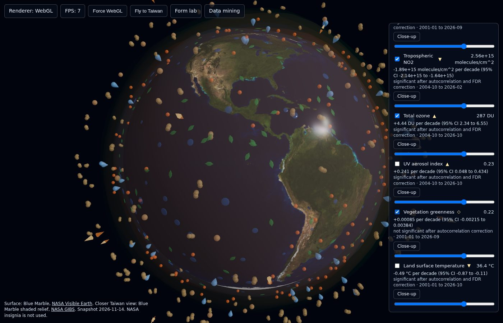
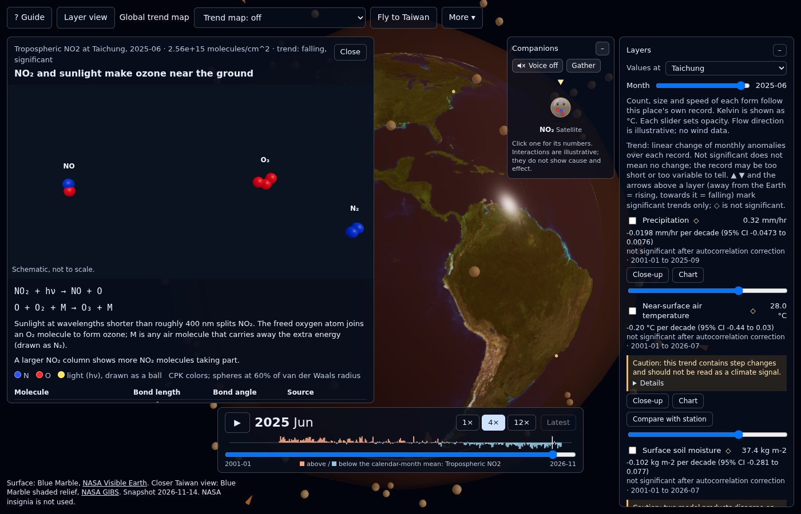
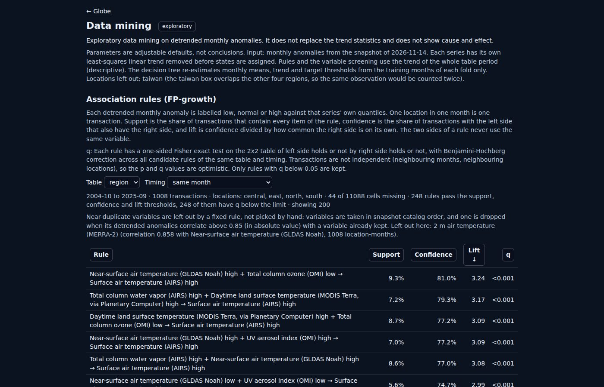

# Earth System Trend Detective

A web globe that shows NASA Earth-observation time series for Taiwan as layers of moving particles, and reports for each variable how fast it has changed per decade, with a 95% confidence interval and a significance test. It is our entry for the NASA Space Apps Challenge 2026 (Taichung local event), challenge [Be An Earth System Trend Detective!](https://www.spaceappschallenge.org/2026/challenges/earth-system-trend-detective/), and is aimed at students and curious members of the public.

**Live site: <https://nasa-hackathon-2026.github.io/earth-system-trend-detective/>** (static, no login, no server)

> TODO(team): add team name, a one-paragraph project statement in your own words, and the link to the demo (slides or 30-second video).

What it does not do yet, in short: apart from the global trend maps, the site only shows data for five points in Taiwan, the direction particles move in is illustrative (there is no wind data), and the data-mining page is exploratory. Details are under [Limitations](#limitations).

繁體中文摘要在[文末](#繁體中文摘要)。

## What you can do on the site

| Where | What it shows |
|---|---|
| [Globe](https://nasa-hackathon-2026.github.io/earth-system-trend-detective/) | A three.js Earth (NASA Blue Marble surface) with 12 layers you can switch on and off, one per variable: precipitation, near-surface air temperature, surface soil moisture, evapotranspiration, AIRS surface air temperature, total water vapor, MERRA-2 2 m air temperature, tropospheric NO2, total ozone, UV aerosol index, vegetation greenness (NDVI) and land surface temperature. |
| Particle forms | Each layer has its own particle shape and motion (water drops, jittering "thermal" spheres, water and ozone molecules, aerosol grains, leaves, ...). The count, size and speed of the particles follow the value for the selected place and month, scaled between that series' own minimum and maximum. |
| Place and month | Five markers in Taiwan (Taichung, Taipei, Kaohsiung, Hualien, Yushan) choose the place; a month slider chooses the month. A month with no data draws no particles and says "No data". |
| Timeline | A bar at the bottom plays through every month of the record (play/pause, 1, 4 or 12 months per second, "Latest"; Space and the arrow keys work too), and the particle layers follow. A thin strip above the slider shows each month's anomaly of one variable (above or below its calendar-month mean) and marks documented step months. `?month=YYYY-MM` and `?play=1` in the URL set the start. With the system's "reduce motion" setting, `?play=1` does not start playing. |
| Time series chart | The "Chart" button of a layer (or `?chart=<id>`) opens the whole monthly series of that variable at the selected place, as monthly values, anomalies or a 12-month running mean, with the linear trend line and the 95% confidence interval of its slope, the documented step months, and the statistics behind it (change per decade, p value after autocorrelation correction, FDR-adjusted p, Mann-Kendall, Sen slope, period, number of valid months). A cursor follows the timeline month; clicking the chart jumps to that month. Gaps are left as gaps. |
| Trend per layer | The layer panel shows the linear change per decade of the monthly anomalies, its 95% confidence interval, and whether it is significant after autocorrelation and false-discovery-rate correction. ▲ ▼ mark significant rising or falling trends, ◇ marks "not significant". Arrows above a layer on the globe appear only for significant trends. |
| Global trend map | A selector at the top (off by default; `?trendmap=<id>` in the URL) lays the per-cell trend of one of seven variables over the globe: change per decade on a diverging colour scale (precipitation, both air temperatures from GLDAS and MERRA-2, AIRS surface air temperature, evapotranspiration, soil moisture, total water vapor). Cells significant after false-discovery-rate correction are in full colour, the other analysed cells are faded, cells with no data are left clear; colour strength also weakens toward zero change so the surface shows through small trends. The legend gives the unit, the colour range, the period and the method. |
| Close-up | Each layer has a "Close-up" button that opens a schematic view of the substance or process behind the variable (for example NO2 photolysis and ozone formation), with bond lengths and angles taken from NIST CCCBDB and the sources listed in the panel. |
| Data companions | A small panel left of the layer list shows one original character per layer that is switched on (Rain, Vapor, Ozone, NO₂, Haze, Warmth, Leaf, Soil and so on), drawn by code as SVG. Its size follows the month's value within the series' own range, its posture (swollen, level, flattened) whether the month is above, near or below the mean of the same calendar month, and the mark over its head the trend (▲ ▼ only when significant, ◇ when not). Clicking one shows a sentence of data facts only: value, difference from that month's mean, change per decade and its significance, any known-problem caution, and whether the data are in situ, a satellite retrieval or a model. A speaker button (off by default) reads it with the browser's own voice. "Gather" arranges all twelve in one composition; `?companions=gallery` shows them on one page. Interactions between neighbouring companions are illustrative and show no cause and effect. |
| [Data mining](https://nasa-hackathon-2026.github.io/earth-system-trend-detective/mining/) | Exploratory association rules (FP-growth) and a decision tree on detrended monthly anomalies, with the baselines the tree is compared against. |
| [Form lab](https://nasa-hackathon-2026.github.io/earth-system-trend-detective/lab/) | Every particle form and close-up on its own, with a 0 to 1 value slider, for trying out how a value looks. |

| Close-up of tropospheric NO2 | Data mining page |
|---|---|
|  |  |

Screenshots were taken from a local build on 2026-11-14 in a headless browser, so the FPS number in them is not what a normal browser shows.

## Limitations

- **Taiwan points only on screen.** The site reads the point series of five places in Taiwan. Regional means for Taiwan and station series are in the data and in `data/analysis/trends.json`, but are not shown on the globe.
- **Only the trend maps are global on screen.** The globe can show the per-cell trend maps of seven variables (about 1° cells, so detail inside a cell is averaged out; the colour range is a percentile of each map, so colours are not comparable between variables; no step-change detection). The rest of the global data (the monthly grids themselves, the world-wide point and area-mean series and their trends) exists in the data layer (see [NASA data](#nasa-data-and-resources)) but is not connected to the site.
- **Flow direction is illustrative.** The project has no wind data. Particles move in a fixed pattern per layer, and the page says so. Particle forms have no land mask, so leaves and soil water also appear over the sea.
- **Close-up views are schematic** and not to scale. Molecular geometry has a source for each number; the textbook references and size figures (cloud droplets, raindrops, aerosol particles) have not been checked page by page.
- **The time series chart shows one variable at a time**, for the five Taiwan points only. Its trend line is rebuilt from the slope in `data/analysis/trends.json` through the mean of the analysed months (the file stores no intercept), and the shaded band is the confidence interval of the slope, not a prediction interval. The chart does not redo any test in the browser.
- **Trends are linear only**, on monthly anomalies. Step changes from sensor or product-version changes are not detected or corrected. "Not significant" does not mean "no change"; the record may be too short or too variable.
- **The GLDAS air temperature trend contains step changes.** Compared with MERRA-2 over the same land cells, the GLDAS-2.1 global land mean shifts by about +0.4 K in May 2011, +0.6 K in July 2017 and −0.6 K in June 2019; these are months of upgrades to the NOAA GDAS analysis that GLDAS-2.1 uses as forcing. The site shows a caution next to this trend; the series is not corrected. The check and its sources are in [docs/data/gldas-tair-check.md](docs/data/gldas-tair-check.md).
- **GLDAS evapotranspiration has a step in 2024–2025; GLDAS soil moisture disagrees with FLDAS on the sign of the trend.** Compared with FLDAS (same Noah model family, MERRA-2 and CHIRPS forcing) over the same land cells, neither variable shows a clear step in the three months above. GLDAS evapotranspiration runs about 0.1–0.2 mm/day above FLDAS from July 2024 to May 2025, the same months in which its shortwave forcing runs 15–32 W m⁻² above FLDAS; the site shows a caution next to this trend. For 0–10 cm soil moisture the GLDAS global land trend over 2001–2026 is −0.43 kg m⁻² per decade against +0.16 for FLDAS; the two series correlate at only 0.08 and no step could be established. With a single model product to compare against, the check cannot tell which is closer to the truth; the site shows a caution that the two products disagree, and the drying trend should be treated as unconfirmed. See [docs/data/gldas-water-check.md](docs/data/gldas-water-check.md).
- **Data mining is exploratory.** It does not replace the trend tests and does not show cause and effect. The decision tree did not beat its baselines in walk-forward validation (numbers under [Data mining](#data-mining-exploratory)).
- **Units are as provided by each product** (for example K for MERRA-2, °C for NASA POWER); the layer panel converts Kelvin to °C for display only.
- Performance has not been measured on real phones.

## NASA data and resources

All series are stored as monthly values in one common format. The lists below are generated from the snapshot catalog: [docs/data/nasa-data.md](docs/data/nasa-data.md) (NASA products, versions, periods, DOIs) and [docs/data/references.md](docs/data/references.md) (non-NASA data and software).

| Product (variables) | Access route | Used for |
|---|---|---|
| GPM IMERG Final monthly (precipitation); GLDAS Noah (air temperature, soil moisture 0–10 cm, evapotranspiration); AIRS (surface air temperature, total column water vapor); MERRA-2 (2 m air temperature); OMI (tropospheric NO2, total ozone, UV aerosol index) | NASA **Giovanni** time-series API | Point series at five places |
| The same ten variables | NASA **Harmony** / Giovanni averaging service | Area means over five Taiwan boxes |
| MODIS Terra NDVI (MOD13A3) and daytime land surface temperature (MOD11A2) | NASA **AppEEARS** area requests | Area statistics for the Taiwan boxes |
| MODIS Terra MOD11A2 and MOD13Q1 | **Microsoft Planetary Computer** (STAC, cloud-optimized GeoTIFF), statistics computed locally | Point series for the two MODIS layers; a second, separately stored set of area series |
| MERRA-2 2 m air temperature | **NASA POWER** monthly API | Cross-check of the MERRA-2 series |
| IMERG, GLDAS, AIRS, MERRA-2, FLDAS, OMI global grids | NASA CMR + **Earthdata Cloud OPeNDAP** | Global monthly grid cubes; area means computed locally |
| Station air temperature, Taichung and Taipei (NOAA GHCNh; not NASA) | AWS Open Data | Ground validation layer only; monthly means only |

The globe surface is NASA Blue Marble (NASA Visible Earth), and the closer Taiwan view is Blue Marble shaded relief from NASA GIBS. The use of monthly anomalies with a linear trend follows Acker et al. 2009 (SeaWiFS chlorophyll time series), a paper on the challenge's resource list.

How much data there is:

| Tier | Size | In git? | Shown on the site? |
|---|---|---|---|
| **Core snapshot** (`data/snapshot/`) | 16 variables (15 NASA, 1 NOAA station), 12 locations, 128 monthly series: 65 point, 61 area-mean, 2 station. Records start between 2000 and 2004 and run to the latest month available on 2026-11-14. | Yes | Point series of 12 variables |
| **Extended series** (`data/extended/`) | 121 more Giovanni variables at the Taiwan points and 12 world cities, plus the core variables at the world cities: 2,177 point series | No (large) | No |
| **Global grids** (`data/raw/grid/`) | 345 monthly cubes at native resolution (about 90 GB); 4,499 area-mean series for the globe, world regions and Taiwan boxes computed from them | No | No |
| **Grid files for the web** (`data/grid/`) | Seven variables reduced to about 1°: annual mean, monthly climatology, and an exploratory slope without any significance test | Yes | Not yet |

The core data is also available as a SQLite file (about 44 MB) on the [releases page](https://github.com/nasa-hackathon-2026/earth-system-trend-detective/releases/tag/data-2026-11-15); see [docs/data/sqlite.md](docs/data/sqlite.md) for the tables and example queries. Where raw downloads are kept and how each source is fetched is in [docs/data/raw-data.md](docs/data/raw-data.md). Both pages are in Traditional Chinese.

## Methods

### Common format and monthly values

Every series is one JSON file with the same fields (variable, location, aggregation, unit, source request, and a list of months with `value`, `coverage` and `n_samples`), listed in `data/snapshot/catalog.json`. The site and the statistics read only these files, so the site needs no server.

- Daily products (OMI) and 8- or 16-day composites (MODIS) are averaged to months; `coverage` records how much of the month had data. Missing months are left missing, with no gap filling.
- Units are kept as the product provides them.
- Each file records the grid cell actually used. Where a coastal cell is masked, the request is moved one cell inland and both coordinates are recorded.
- "Area mean" is over a latitude–longitude box, not a land mask, so it includes sea cells for every product except the land-only models. Comparing absolute values across products is misleading. `coverage` is defined differently by source.

### Trend statistics

For each series (`src/trend_detective/trends.py`, results in [`data/analysis/trends.json`](data/analysis/trends.json)):

1. Months with coverage below 0.25 are dropped. A series with fewer than 120 usable months or more than 20% missing is marked `insufficient` and not tested.
2. **Monthly anomalies**: each value minus the mean of the same calendar month, which removes the seasonal cycle.
3. **Linear trend**: least-squares slope of the anomalies, reported per decade. The standard error, t-test and 95% confidence interval use an effective sample size from the lag-1 autocorrelation of the residuals (Santer et al. 2000).
4. **Mann-Kendall** in three versions (original, Hamed-Rao variance correction, seasonal) and the **Theil-Sen slope** with its confidence interval.
5. **Benjamini-Hochberg FDR** across all series of the run, separately for each test.

The site uses the autocorrelation-corrected t-test with FDR for its "significant" label.

Results of the run on the 2026-11-14 snapshot ([`trends.run.json`](data/analysis/trends.run.json)): of 128 series, 125 were analysed and 3 had too many missing months (tropospheric NO2 at Hualien, Taipei and Yushan).

| Test | Series tested | p < 0.05 | Still below 0.05 after FDR |
|---|---|---|---|
| Linear trend, t-test with autocorrelation correction | 125 | 81 | 74 |
| Linear trend, t-test without correction (for comparison) | 125 | 97 | not computed |
| Mann-Kendall, original | 125 | 87 | 86 |
| Mann-Kendall, Hamed-Rao | 124 | 69 | 65 |
| Seasonal Mann-Kendall | 125 | 88 | 86 |

These are counts of series, many of which are closely related (the same variable at neighbouring places, products derived from the same source), so they are not 125 independent findings.

Known pitfalls and how they are handled:

| Pitfall | Handling |
|---|---|
| Autocorrelation makes p-values too small | Effective sample size for the t-test. On synthetic AR(1) series (phi 0.7, 240 months, 300 runs) the false-positive rate was 38% uncorrected, 6% corrected, and 18% for Hamed-Rao, so the Hamed-Rao result is on the lenient side. The Sen slope interval has no autocorrelation correction. |
| Seasonal cycle | Monthly anomalies; the seasonal Mann-Kendall test as a second view. |
| Many tests at once | Benjamini-Hochberg FDR; both raw and adjusted results are stored. |
| Short or gappy records | Minimum of 120 usable months and at most 20% missing, otherwise not tested. |
| Sensor or product-version changes | **Not handled.** A step change would be read as a trend. |

### Data mining (exploratory)

`src/trend_detective/mining.py`, results in [`data/analysis/fpgrowth.json`](data/analysis/fpgrowth.json) and [`decision_tree.json`](data/analysis/decision_tree.json), both marked `exploratory: true`.

- **Input**: monthly anomalies with each series' own linear trend removed, so the states describe month-to-month variation, not the long-term trend. Each value is labelled low, normal or high by that series' own terciles. One place in one month is one row.
- **Near-duplicate variables** are dropped by a fixed rule (absolute correlation above 0.85 with a variable earlier in the catalog). In this run that removed NASA POWER temperature from the point table (r = 1.000 with MERRA-2) and MERRA-2 temperature from the region table (r = 0.858 with GLDAS).
- **Association rules (FP-growth)**: minimum support 0.05, confidence 0.6, lift 1.5, at most three items, the two sides never the same variable. Each rule gets a one-sided Fisher exact test with FDR correction. Result: 368 same-month rules from 1,260 point rows; 248 same-month rules and 1 one-month-lag rule from 1,008 region rows. Every candidate rule passed the significance filter, because rows are not independent (neighbouring months and places) and the p-values are therefore optimistic; in practice the lift threshold does the filtering.
- **Decision tree**: predicts the low/normal/high state of regional NDVI from the other variables in the same and the previous month (depth 3), with three walk-forward folds. NDVI's own previous month and the second NDVI series are not allowed as features. Monthly means, trend and thresholds are estimated from the training months of each fold only.

Decision tree test accuracy against three guesses that use no other variable:

| Fold (test period) | Tree | Always guess the training period's most common class | Always guess the test period's most common class (known only afterwards) | Same as the previous month |
|---|---|---|---|---|
| 1 (2014-11 to 2018-04) | 0.460 | 0.270 | 0.468 | 0.484 |
| 2 (2018-05 to 2021-10) | 0.421 | 0.325 | 0.421 | 0.556 |
| 3 (2021-11 to 2025-06) | 0.317 | 0.349 | 0.405 | 0.603 |

The tree is above all three baselines in 0 of 3 folds. We report it as it is: with these inputs the tree has no demonstrated predictive value, and the page says so.

## How to reproduce

You need [uv](https://docs.astral.sh/uv/) (Python 3.11 or later) and Node.js 22 or later. Run everything from the repository root. The commands in the first table need no account and no network beyond package installation; each was run on a clean checkout on 2026-11-15.

| Step | Command | Notes |
|---|---|---|
| Install the data layer | `uv sync --locked` | |
| Run its tests | `uv run pytest` | 324 passed |
| Recompute trend statistics | `uv run python -m trend_detective.trends` | About 3 s. Reads `data/snapshot/`, writes `data/analysis/trends.json`, `anomalies.json`, `trends.run.json`. Only the run timestamp changes if the data is unchanged. |
| Recompute data mining | `uv run python -m trend_detective.mining` | About 3 s. Run after the trend step. |
| Regenerate the data lists | `uv run python -m trend_detective.data_lists` | Rewrites `docs/data/nasa-data.md` and `references.md` from the catalog. |
| Build the SQLite file | `uv run python -m trend_detective.sqlite_export` | Writes `data/sqlite/trend_detective.sqlite` (not in git). On a fresh clone the unified table is complete (128 series, 37,709 rows) and the per-source raw tables are empty, because raw downloads are not in git. |
| Install the web app | `npm ci --prefix web` | |
| Run its tests | `npm test --prefix web` | 102 passed |
| Start the site locally | `npm run dev --prefix web` | Open `http://localhost:5173/earth-system-trend-detective/` (also `lab/` and `mining/` under it). |
| Build the site | `npm run build --prefix web` | Output in `web/dist/`, including a copy of `data/snapshot/` and `data/analysis/`. GitHub Pages runs this on every push to `main`. |

Fetching the data again talks to NASA services. These commands were **not** re-run for this README; they are documented in `AGENTS.md` (in Traditional Chinese) with timings and pitfalls.

| Step | Command | Needs |
|---|---|---|
| Regenerate the whole core snapshot | `uv run python -m trend_detective.snapshot` | An Earthdata Login token as `EARTHDATA_TOKEN` in a local `.env` for Giovanni and Harmony. Without it those two sources are skipped and existing files are kept. Uses the team's shared Giovanni quota. About 3–10 minutes. |
| Only the sources that need no account | `uv run python -m trend_detective.snapshot --source noaa_ghcnh --source nasa_power` | Network only. |
| MODIS via Planetary Computer | `uv run python -m trend_detective.planetary_computer fetch`, then `uv run python -m trend_detective.snapshot --source planetary_computer` | No account. About 9 minutes and 1.5 GB of downloads. |
| MODIS via AppEEARS | `uv run python -m trend_detective.appeears submit`, later `status` and `download` | An AppEEARS token (`APPEEARS_TOKEN`). Tasks are asynchronous and can queue for hours. |
| Extended series | `uv run python -m trend_detective.extended` | `EARTHDATA_TOKEN`. Point series only by default; continental area means through Harmony use up the shared quota and are not sent. |
| Global grids | `uv run python -m trend_detective.grid_fetch` (see `AGENTS.md` for the per-product options) | `EARTHDATA_TOKEN`. Tens of GB of downloads. |
| Area means from the grids | `uv run python -m trend_detective.grid_regions` | Offline, but needs the grid cubes from the previous step. |

## Repository layout

| Path | Contents |
|---|---|
| `data/snapshot/` | Core snapshot: `catalog.json` and one JSON file per series. Read by the site. |
| `data/analysis/` | Trend and data-mining results with their run records (`*.run.json`). Read by the site. |
| `data/grid/` | Reduced global grid files for seven variables. The site reads the trend maps (`meta.json`, `trend_slope_per_decade.i16`, `trend_significance.u8`); the annual means and monthly climatologies are not used by the site yet. |
| `data/seed/` | Lists of variables, locations and grid products that drive the fetch scripts. |
| `data/raw/`, `data/extended/`, `data/sqlite/` | Raw downloads, extended series, SQLite export. Not in git. |
| `src/trend_detective/` | Python data layer: one module per source, plus `snapshot`, `trends`, `mining`, `grid*`, `sqlite_export`. |
| `tests/` | pytest tests for the data layer, with small fixtures; they do not use the network. |
| `web/` | Vite + React + three.js site: the globe (`web/src/`), the form lab (`web/lab/`), the mining page (`web/mining/`), and a minimal line-chart check page (`web/tracer/`). |
| `docs/data/` | Generated data lists, raw-data notes, SQLite guide. |
| `docs/images/` | Screenshots used in this README. |
| `docs/agents/`, `AGENTS.md`, `CLAUDE.md`, `.claude/`, `.codex/` | Instructions and configuration for the coding agents used in development; see [docs/agents/README.md](docs/agents/README.md). |
| `.github/` | Issue and pull-request templates, and the GitHub Pages workflow. |

## Use of AI (SI) — disclosure (draft)

Space Apps 2026 calls AI tools "Super Intelligence (SI)". This section is a draft assembled from the repository's own record (commit trailers, pull-request descriptions, issue comments). Items the record cannot settle are marked for the team.

What was done with AI tools:

- **Data layer** (`src/`, `tests/`, the fetch scripts, the common format, trend statistics, data mining, SQLite export), the data documentation and this README: written by **Claude Code (Anthropic)** under a team member's direction. Those commits carry a `Co-Authored-By: Claude` trailer and the pull requests say "Generated with Claude Code".
- **Web front end, main structure** (three.js scene, globe, layers, form lab, reading the snapshot; pull requests #27, #29, #30, #33, #38, #42, #44): developed by a team member using **Cursor**. Those commits carry a `Co-authored-by: Cursor` trailer and the pull requests say "Made with Cursor".
- **Web front end, later parts** (trend summary in the layer panel, the mining page, the ten additional particle forms, the close-up views and their text; pull requests #57, #58, #62, #65): implemented by Claude Code. The mapping from each variable to a particle shape and the wording and reaction equations in the close-ups were first drafted by the tool as defaults for the team to change ([#60](https://github.com/nasa-hackathon-2026/earth-system-trend-detective/issues/60)).
- **Data companions** (the characters in the companion panel): the idea of one pet-like character per form of matter, shown together in a composition after *The School of Athens*, is the team's; the code that draws the characters and fills in their sentences was written by an AI tool (Claude Code) following the team's design. The characters are drawn by that code as SVG shapes; no AI-generated image, no external image, font or audio file is used, and the voice is the browser's built-in speech synthesis. The sentences are templates filled with numbers from the data; they state no cause and no conclusion.
- **Data-mining parameters**: the default thresholds were chosen by the tool following rules a team member authorised, and are recorded in the result files ([#59](https://github.com/nasa-hackathon-2026/earth-system-trend-detective/issues/59)).

What was decided by team members, as recorded in the issues:

- The layered-globe design, one glass-and-particle layer per variable ([#19](https://github.com/nasa-hackathon-2026/earth-system-trend-detective/issues/19)), and the first two particle forms ([#20](https://github.com/nasa-hackathon-2026/earth-system-trend-detective/issues/20)).
- The visual direction of a far view of particles and a close-up of molecules and processes, with values driving count, size and speed ([#60](https://github.com/nasa-hackathon-2026/earth-system-trend-detective/issues/60)).
- Starting with Taiwan, and using decision trees and FP-growth as the data-mining methods ([#55](https://github.com/nasa-hackathon-2026/earth-system-trend-detective/issues/55)).

What is not AI-generated:

- **All data values** come from the NASA products, NASA POWER and NOAA GHCNh listed above, through the scripts in this repository. No value is generated or filled in by an AI model. The statistics are computed by ordinary code (NumPy, SciPy, pymannkendall, mlxtend, scikit-learn).
- The screenshots are captures of the running site. The globe textures are NASA imagery. No NASA logo or insignia is used.

> TODO(team): confirm that the idea for the project came from the team's own brainstorm ([#3](https://github.com/nasa-hackathon-2026/earth-system-trend-detective/issues/3)) and say so here in your own words. The rules state that SI must not be used to come up with the idea.

> TODO(team): confirm the list above is complete. In particular: were other AI tools used (for example for the demo slides or video, images, translation, or research)? Were issue texts and specifications drafted with an AI tool? Is any image, icon, audio or video in the submission AI-generated (these need a visible watermark)? Who made the decisions recorded in the data-layer spec ([#4](https://github.com/nasa-hackathon-2026/earth-system-trend-detective/issues/4))?

> TODO(team): the team's own checklist proposed a header comment in AI-written source files. This has not been done; decide whether this section is enough.

> TODO(team): the textbook references and size figures in the close-up views were drafted by the tool and have not been checked against the books. Check them or mark them in the page.

## Team

> TODO(team): team name, members, and roles.

## License

> TODO(team): this repository has no `LICENSE` file yet. According to our notes on the 2026 Participant Terms & Conditions (<https://www.spaceappschallenge.org/legal/>), original content is treated as open source, and NASA distributes it under Apache 2.0 when no OSI licence is specified. Choose a licence and add the file.

## Acknowledgements and data notices

- NASA data products and their DOIs are listed in [docs/data/nasa-data.md](docs/data/nasa-data.md); non-NASA data and Python packages in [docs/data/references.md](docs/data/references.md). The web app is built with three.js, React, @react-three/fiber, @react-three/drei and Vite.
- NASA POWER: "The data was obtained from the National Aeronautics and Space Administration (NASA) Langley Research Center (LaRC) Prediction of Worldwide Energy Resources (POWER) Project funded through the NASA Earth Science Division."
- Station temperatures are from NOAA NCEI GHCNh, accessed through AWS Open Data; the original observations are from Taiwan's Central Weather Administration, exchanged through WMO. Only monthly means are included, for educational, non-commercial use. No endorsement by NOAA is implied.
- MODIS data reached through Microsoft Planetary Computer remain NASA products and are cited as such.
- The "Gather" arrangement of the data companions borrows the idea of the composition of Raphael, *The School of Athens* (fresco, 1509–1511, Stanza della Segnatura, Vatican; public domain): two figures in the middle, one pointing up and one holding a palm towards the ground, the others in groups on the steps. No part of the painting is reproduced. The companions are original characters and do not depict any existing character.
- Molecular geometry in the close-up views is from the NIST Computational Chemistry Comparison and Benchmark Database (CCCBDB).
- This project does not use the NASA insignia and is not endorsed by NASA.

> TODO(team): mentors, organisers or others to thank.

## 繁體中文摘要

這是 NASA Space Apps Challenge 2026 台中場「Be An Earth System Trend Detective!」的作品。網站用 three.js 地球呈現 12 個 NASA 地球觀測變數在台灣 5 個點位的月資料：每個變數一層粒子，數量、大小、速度跟著數值變；圖層面板列出每個變數每十年的變化量、95% 信賴區間與顯著性（月距平的線性趨勢，t 檢定經自相關修正並做 FDR 校正）。另有探索性的資料探勘頁面與展示實驗場。

目前的限制：畫面只有台灣 5 個點位；流動方向是示意（沒有風向資料）；全球資料只有 7 個變數的趨勢地圖接到畫面（地球上方的 Global trend map 選單），其餘全球格點與世界各地的序列還沒接上；探勘是探索性的，決策樹在走動驗證的 3 折中沒有任何一折高於全部基準。

資料來源、方法、重現步驟與 AI（SI）使用揭露的草稿見上方各節；標有 `TODO(team)` 的地方需要隊伍確認或補充。開發用的 agent 設定說明在 [docs/agents/README.md](docs/agents/README.md)。
