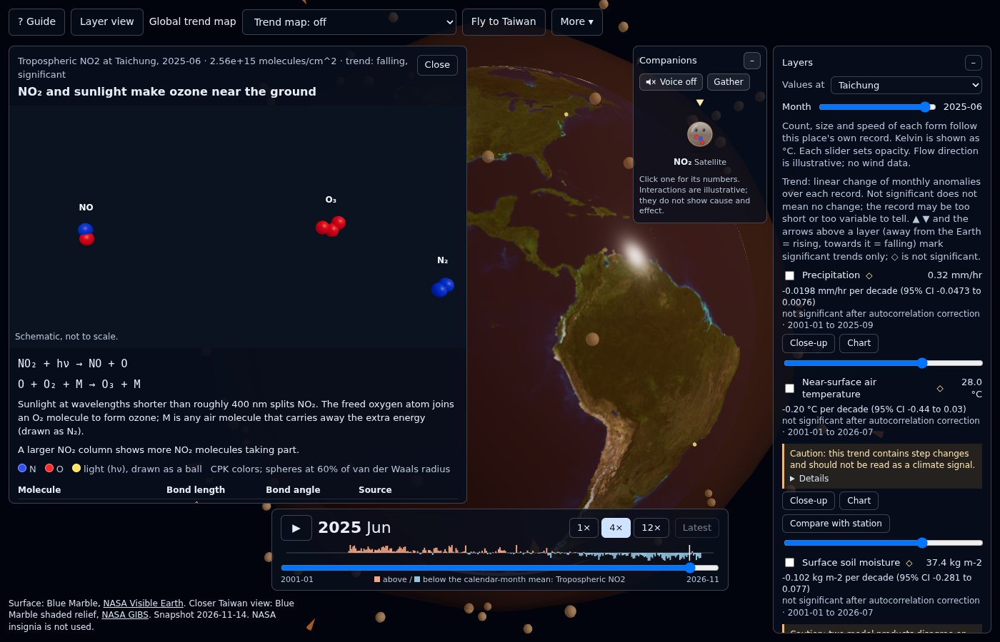
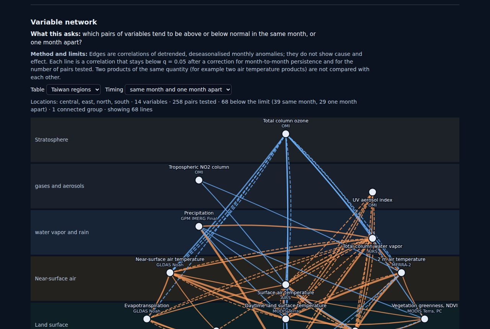

# Site guide

What each view of the site shows and how to use it, step by step. Read this to find a feature or to prepare a demonstration; the limits of each view are in [limitations.md](limitations.md). Back to the [README](../README.md).

## What you can do on the site

| Where | What it shows |
|---|---|
| Start card | The first visit opens with two layers already on (precipitation and MERRA-2 2 m air temperature at Taichung) and a card that says what the tool does, gives three steps (turn on a layer, play or drag the timeline, open Chart) and offers five examples to open. "How to read this" in the card explains the particles (one value at the selected place, not a map), the ▲ ▼ △ ▽ ◇ marks and the crossed-out triangle, what "not significant" means, the difference between in situ, satellite and model data, and the orange caution notes. The card closes for good once dismissed (remembered in the browser); the "? Guide" button at the top brings it back. A link that sets the view (`?layers=`, `?chart=`, ...) opens exactly that view, without the card. |
| Guided tour | On a first visit a data companion walks through the four questions of the challenge in four short chapters, numbered like the tabs of the investigation panel: ① what is changing, ② where, ③ how much (anomalies, change per decade, 95% confidence interval), ④ whether it is significant (two tests; "not significant" is not "no change"; a record with a documented data problem). Each step marks the panel it talks about. Next, Back, Skip, the chapter numbers and the keyboard (Enter or →, ←, Esc) move through it; leaving puts back your layers, place and month. "Take the tour" in the start card reopens it, and `?tour=1` to `?tour=4` opens it at a chapter. |
| [Globe](https://nasa-hackathon-2026.github.io/earth-system-trend-detective/) | A three.js Earth (NASA Blue Marble surface) with 12 layers you can switch on and off, one per variable: precipitation, near-surface air temperature, surface soil moisture, evapotranspiration, AIRS surface air temperature, total water vapor, MERRA-2 2 m air temperature, tropospheric NO2, total ozone, UV aerosol index, vegetation greenness (NDVI) and land surface temperature. |
| Particle forms | Each layer has its own particle shape and motion (water drops, jittering "thermal" spheres, water and ozone molecules, aerosol grains, leaves, ...). The count, size and speed of the particles follow the value for the selected place and month, scaled between that series' own minimum and maximum. |
| Calm particle style | A switch at the top of the Layers panel ("Particles: Calm / Lively", or `?particles=calm` in the URL; the choice is remembered in the browser) replaces the particles around the globe with one small, slow cluster per layer above the selected place. A small shape is one unit and five units combine into one big shape, on a scale of 1 to 25 units between that series' own lowest and highest month; the tinted disc is this month and the thin white ring is the mean of the same calendar month over the record, so a disc larger than the ring is a month above usual. A month with no data leaves a dashed ring only. The cluster gets smaller on screen as the camera moves closer, so it does not cover the map. Lively is the default. |
| Place and month | The place menu at the top of the Layers panel ("Values at", or `?at=<place id>`) chooses the place: five points in Taiwan (Taichung, Taipei, Kaohsiung, Hualien, Yushan), five Taiwan regions as area means (`?at=taiwan`, `north`, `central`, `south`, `east`; the globe outlines the data area, and the layer view is not offered for a region), twelve world cities (Tokyo, Delhi, Beijing, Jakarta, Cairo, Lagos, London, Moscow, New York, Los Angeles, São Paulo, Sydney) or the global mean. Picking a place turns the globe to it; the markers on the globe choose a place too. The month, every layer's value and trend, the chart, the companions and the layer view follow the place. A month slider chooses the month. A month with no data draws no particles and says "No data"; a variable with no series at the place says "No data at this place". |
| Timeline | A bar at the bottom plays through every month of the record (play/pause, 0.5, 2 or 6 months per second, "Latest"; Space and the arrow keys work too), and the particle layers follow. A thin strip above the slider shows each month's anomaly of one variable (above or below its calendar-month mean) and marks documented step months. `?month=YYYY-MM` and `?play=1` in the URL set the start. With the system's "reduce motion" setting, `?play=1` does not start playing. |
| Investigation panel (Chart) | The "Chart" button of a layer (or `?chart=<id>`) opens the investigation panel for that variable at the selected place: four numbered tabs, one per question of the challenge (`?tab=what|where|howmuch|significant` opens one directly). Each tab starts with a one-sentence answer generated from the results file and the same marks as the Layers panel, then a chart. ① What: the whole monthly record (values or 12-month running mean) with the trend line, the seasonal cycle that anomalies remove, the definition, unit, data type, product and period, and the other variables of the same question group (water, heat, air, plants). ② Where: one small chart of anomalies and trend per place (Taiwan points and regions, 12 world cities, global mean) on a shared or own scale; click one to go there. ③ How much: monthly anomalies with the trend and the 95% confidence band of its slope, the OLS and Sen changes per decade with their intervals on a number line centred on 0, the linear conversion over the period, and the numbers. ④ Significant?: the autocorrelation-corrected t-test and the three Mann-Kendall tests side by side with p, FDR-adjusted q and the same lights, a note when the two disagree, and the sentence that "not significant" is not "no change". Researchers also get residuals with months beyond ±3 robust SD, the residual autocorrelation (lags 1–24), the anomaly histogram and yearly means, a CSV and JSON download of the series and its result, and the methods. A cursor follows the timeline month; clicking a time chart jumps to that month. p values always come from the results file. |
| Trend per layer | The layer panel shows the linear change per decade of the monthly anomalies, its 95% confidence interval, and whether it is significant after autocorrelation and false-discovery-rate correction. ▲ ▼ mark significant rising or falling trends, hollow △ ▽ trends that are significant only before the FDR correction, ◇ marks "not significant". A significant trend of a series with a documented data issue that affects trends (a step in the product, or two products that disagree on the sign) gets a crossed-out triangle instead and the wording "statistically significant, but not reliable as a climate signal: see caution". Arrows above a layer on the globe appear only for significant trends without such an issue. The page opens with the camera over the selected place, which carries a ring and its name; a line under the timeline says that the particles show one value at that place and month and are not a map. |
| Global trend map | A selector at the top (off by default; `?trendmap=<id>` in the URL) lays the per-cell trend of one of seven variables over the globe: change per decade on a diverging colour scale (precipitation, both air temperatures from GLDAS and MERRA-2, AIRS surface air temperature, evapotranspiration, soil moisture, total water vapor). Cells significant after false-discovery-rate correction are in full colour, the other analysed cells are faded, cells with no data are left clear; colour strength also weakens toward zero change so the surface shows through small trends. The same selection also scatters dots of that variable over the globe, each in the trend colour of the cell it sits in. Moving the timeline changes the strength of the colours, not the colours: a cell is brighter in the calendar months in which its value is usually higher. That is the mean seasonal cycle over the record, which repeats every year; it is not the value of the selected year and month, and the trend stays one number for the whole record. The legend gives the unit, the colour range, the period and the method, and says so. An older link with `?field=<id>` opens the same map. |
| Close-up | Each layer has a "Close-up" button that opens a schematic view of the substance or process behind the variable (for example NO2 photolysis and ozone formation), with bond lengths and angles taken from NIST CCCBDB and the sources listed in the panel. |
| Data companions | A small panel left of the layer list shows one original character per layer (Rain, Vapor, Ozone, NO₂, Haze, Warmth, Leaf, Soil and so on), drawn by code as SVG. The characters of the layers that are switched on are drawn in full; the others are small faded heads below them, and clicking one switches its layer on (the heading counts them, for example "Companions · 2 of 12"). Its size follows the month's value within the series' own range, its posture (swollen, level, flattened) whether the month is above, near or below the mean of the same calendar month, and the mark over its head the trend (▲ ▼ only when significant, ◇ when not, a crossed-out triangle when significant but not reliable as a climate signal). Clicking one shows a sentence of data facts only: value, difference from that month's mean, change per decade and its significance, any known-problem caution, and whether the data are in situ, a satellite retrieval or a model. A speaker button (off by default) reads it with the browser's own voice. "All 12 together" arranges all twelve in one composition (`?companions=gather`); `?companions=gallery` shows them on one page. Interactions between neighbouring companions are illustrative and show no cause and effect. |
| Layer view | The "Layer view" button (also offered once you zoom in, or `?strata=1&at=<place id>` in the URL) flies to the selected place, tilts to an oblique view and pulls the Earth system there apart into six stacked platforms: stratosphere, troposphere (gases and aerosols), troposphere (water vapor and rain), near-surface air, land surface and top soil. Each platform lists its variables with the month's values and draws the particles of the layers that are switched on; rain falls from its platform to the land surface and evapotranspiration rises from it. Drag to turn, scroll to zoom, click a platform for its values, trend per decade, significance and cautions. The timeline keeps playing in this view, and a layer's "Chart" opens beside the Layers panel, so the stack, the six labels and the chart are visible together on a wide window. When the window is wide and tall enough, the companions of the switched-on layers stand in a column to the right of the stack, each at the height of its platform; otherwise they stand on the platforms. On a touch screen two fingers pinch to zoom, and "Reset view" or a double click returns to the starting view. |
| [Model vs observation](https://nasa-hackathon-2026.github.io/earth-system-trend-detective/compare/) | Near-surface air temperature from models and reanalyses next to observations of the same quantity at the same place. Under "More" at the top of the globe page. |
| [Data mining](https://nasa-hackathon-2026.github.io/earth-system-trend-detective/mining/) | Five exploratory analyses, each with its method, sample size and a comparison against simple guesses: association rules (FP-growth) shown as small "A high and B low → C high" labels; a variable network (correlations of detrended monthly anomalies, drawn by layer of the Earth system, with the same lines as a table and a cross-check over 12 world cities); similar series (pick a place and a variable to list the most and least similar other variables, with small overlaid lines); where models and observations differ (mean size of the model-minus-station temperature difference by product, season, period and station, and a decision tree compared with three baselines, forward in time and on a held-out station); and the earlier decision tree for vegetation greenness, which did not beat its baselines. The chart panel of the globe page links to "Similar series" for the place and variable on screen. |
| [Form lab](https://nasa-hackathon-2026.github.io/earth-system-trend-detective/lab/) | Every particle form and close-up on its own, with a 0 to 1 value slider, for trying out how a value looks. |

| Close-up of tropospheric NO2 | Data mining page |
|---|---|
|  |  |

Screenshots were taken from a local build on 2026-11-15 in a headless browser, which draws fewer frames per second than a normal browser. They were taken before that day's later changes to the top row, the companion panel and the trend map, so the live site looks slightly different.

## How to use

1. Open the [globe](https://nasa-hackathon-2026.github.io/earth-system-trend-detective/). Two layers are on; the start card lists the steps and the examples.
2. Pick a place in "Values at" at the top of the Layers panel on the right (Taiwan, a world city or the global mean); the globe turns to it. Tick a layer below. The numbers next to it are the value at the selected place in the month shown, and the trend per decade with its significance. The "Particles" switch at the top of the panel chooses how the layers are drawn: Lively (particles around the globe) or Calm (one countable cluster per layer above the place, with a ring for what is usual for the month); `?particles=calm` or `?particles=lively` in the URL does the same.
3. Press play on the timeline at the bottom, or drag it, to watch the months go by.
4. Press "Chart" on a layer to open the investigation panel: four tabs (What is changing? Where? How much? Is it significant?), each with a one-sentence answer and a chart. Arrow keys move between the tabs; "Expand" widens the panel. `?chart=<id>&tab=howmuch` opens a tab directly.
5. "Layer view" shows which layer of the atmosphere or ground each variable belongs to; "Global trend map" lays one variable's per-cell trend over the globe; "More" leads to the model vs observation, data mining and form lab pages (and holds the renderer and FPS readout).
   "Fly near me" (top row, wide windows only) asks the browser for this device's location only when it is pressed and uses it inside the page to pick the nearest Taiwan point or world city; the location is not stored and not sent anywhere. Without a location (refused, unavailable or timed out) it flies to Taiwan.
6. On the data mining page, the row of links at the top jumps to each analysis; every section starts with the question it asks and its limits, and "Method details" opens the full method and parameters. "Similar series" at the bottom of a chart on the globe page opens that place and variable there.
